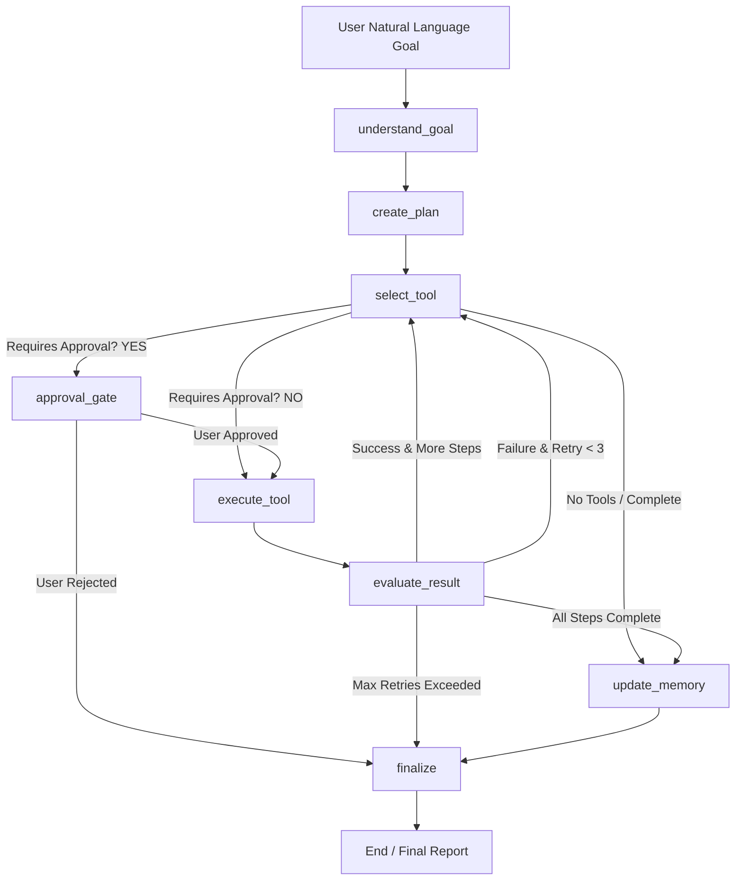

# Autonomous Personal Task Agent Architecture Specification

## 1. System Overview

The **Autonomous Personal Task Agent** transforms standard Large Language Model (LLM) conversational interfaces into a goal-driven, autonomous task execution system. The architecture features:

- **ML Intent Classifier**: Custom-trained model (TF-IDF + Logistic Regression Baseline vs Transformer Embedding MLP Classifier) for intent and tool requirement prediction.
- **LangGraph State Graph**: Cyclic state machine orchestrating goal understanding, planning, tool selection, human approval gates, execution, failure evaluation, and memory persistence.
- **Dual Memory Layer**: Short-Term state memory (transient task state) + Long-Term persistent memory (ChromaDB vector store + SQLite metadata).
- **Human-in-the-Loop Safety Gate**: Interactive approval pause before executing sensitive tools like `send_email`.
- **FastAPI & Streamlit**: Asynchronous REST backend with SSE streaming execution trace and a dark-mode Streamlit UI.

---

## 2. LangGraph State Machine Diagram

---

## 3. Core Component Modules

| Module | File Location | Responsibility |
|---|---|---|
| **Data & ML** | `data/`, `models/` | Synthetic task dataset generation, cleaning, 70/15/15 splitting, baseline & embedding model training & evaluation. |
| **Database** | `db/` | SQLite database, schema migrations, CRUD helper functions for `users`, `tasks`, `task_steps`, `memories`. |
| **Memory** | `memory/` | Short-term state scratchpad & ChromaDB vector embedding long-term memory store. |
| **Tools** | `tools/` | Standardized `BaseTool` interface, `ToolRegistry`, Web Search, Task Manager, APScheduler, Calendar, Email, Memory tools. |
| **Agent Core** | `agent/` | Pydantic/TypedDict `AgentState`, graph nodes, conditional routing edges, LangGraph/Native compiled workflow graph. |
| **API Backend** | `api/` | FastAPI server endpoints (`/agent/run`, `/agent/approve`, `/tasks`, `/memory`) with Server-Sent Events. |
| **UI** | `ui/` | Glassmorphic Streamlit frontend with real-time execution trace visualization, interactive approval dialogs, and benchmark lab. |
