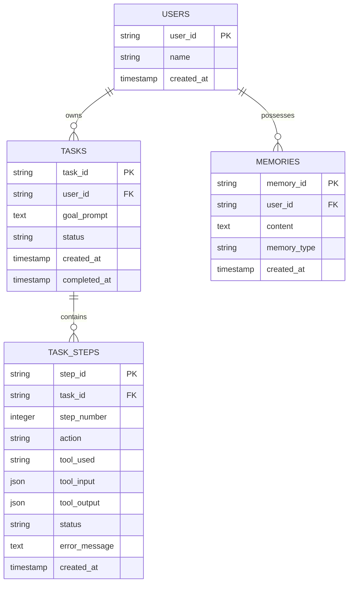

# Database Entity-Relationship (ER) Diagram Specification

## SQLite Schema Overview

The database uses four relational tables to store user information, task objectives, granular tool step traces, and long-term memories.

---

## Data Dictionaries

### 1. `users` Table
| Column | Type | Constraints | Description |
|---|---|---|---|
| `user_id` | String | PRIMARY KEY | Unique user identifier |
| `name` | String | NOT NULL | User's full display name |
| `created_at` | Timestamp | DEFAULT NOW | Record creation timestamp |

### 2. `tasks` Table
| Column | Type | Constraints | Description |
|---|---|---|---|
| `task_id` | String | PRIMARY KEY | Unique task execution ID |
| `user_id` | String | FOREIGN KEY | Owner user ID |
| `goal_prompt` | Text | NOT NULL | Original natural language objective |
| `status` | String | NOT NULL | `PENDING`, `IN_PROGRESS`, `AWAITING_APPROVAL`, `COMPLETED`, `FAILED` |
| `created_at` | Timestamp | DEFAULT NOW | Task initiation timestamp |
| `completed_at` | Timestamp | NULLABLE | Completion timestamp |

### 3. `task_steps` Table
| Column | Type | Constraints | Description |
|---|---|---|---|
| `step_id` | String | PRIMARY KEY | Unique step execution ID |
| `task_id` | String | FOREIGN KEY | Parent task ID |
| `step_number` | Integer | NOT NULL | Sequential step number |
| `action` | String | NOT NULL | Action description |
| `tool_used` | String | NULLABLE | Tool name invoked |
| `tool_input` | JSON / Text | NULLABLE | JSON parameters passed to tool |
| `tool_output` | JSON / Text | NULLABLE | JSON result returned by tool |
| `status` | String | NOT NULL | `SUCCESS`, `FAILED`, `RETRYING` |
| `error_message` | Text | NULLABLE | Error details if step failed |
| `created_at` | Timestamp | DEFAULT NOW | Step timestamp |

### 4. `memories` Table
| Column | Type | Constraints | Description |
|---|---|---|---|
| `memory_id` | String | PRIMARY KEY | Unique memory item ID |
| `user_id` | String | FOREIGN KEY | Owner user ID |
| `content` | Text | NOT NULL | Saved memory content / preference |
| `memory_type` | String | NOT NULL | `preference`, `note`, `background` |
| `created_at` | Timestamp | DEFAULT NOW | Memory creation timestamp |
